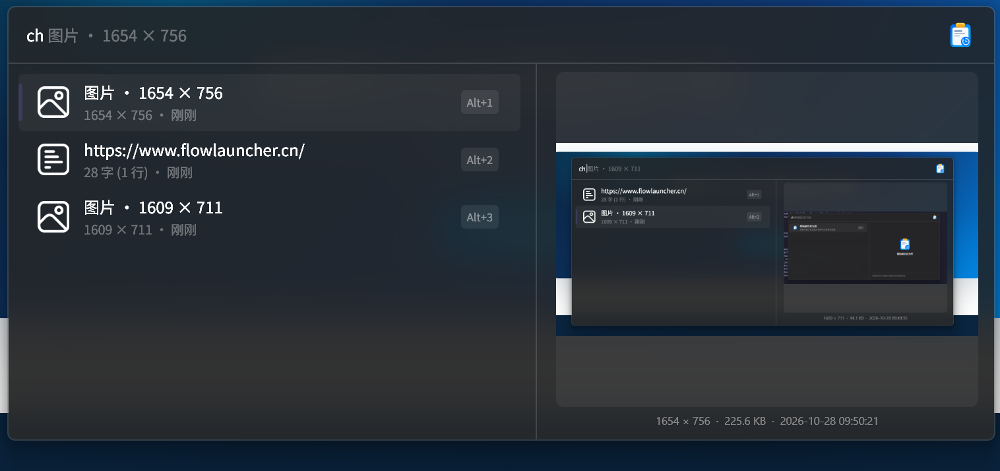

# Flow.Plugin.ClipHistory

A lightweight, fast, and reliable clipboard history plugin for [Flow Launcher](https://github.com/Flow-Launcher/Flow.Launcher).



---

## Features

- **Real-Time Monitoring**: Captures clipboard updates via Windows `AddClipboardFormatListener` Win32 API on a dedicated background STA thread with minimal resource footprint.
- **Native Fuzzy & Pinyin Search**: Powered by Flow Launcher's core search engine (`API.FuzzySearch`) with full support for Chinese Pinyin, Pinyin initials, precision scoring, and title character highlighting.
- **Text & Image History**:
  - **Text**: Automatically stores copied text with character count, line count, and friendly timestamps.
  - **Images**: Automatically captures copied images, stores high-resolution files locally, and generates lightweight thumbnails for instant list rendering.
- **Side-Panel Previews**:
  - **Text**: Scrollable full-content preview card with detailed metadata.
  - **Image**: High-resolution image card showing dimensions ($Width \times Height$) and file info.
- **Pinning**: Pin frequently used records to the top; pinned items are safely preserved when regular history is cleared.
- **Quick Copy**: Press `Enter` on any record to copy it back to your clipboard.
- **Context Menu**:
  - **Copy**: Copy the item to your clipboard.
  - **Pin to Top / Unpin**: Toggle pinned state.
  - **Delete**: Permanently remove an item from history (also deletes cached image files).
- **SQLite Persistence**: Embedded SQLite with WAL mode ensures fast querying and reliable persistence across restarts.
- **Configurable Settings**:
  - Adjust maximum history records (default: 500).
  - Adjust maximum single item size in KB (default: 1024 KB).
  - One-click buttons to clear unpinned records or wipe all history.

---

## Action Keywords & Usage

The default action keyword is **`ch`** (can also be triggered with `clip`, or customized in Flow Launcher Settings):

| Query | Description |
| :--- | :--- |
| `ch` | Browse recent clipboard records (pinned items appear first) |
| `ch <query>` | Search clipboard history with fuzzy and Pinyin matching |
| `ch set` / `config` | Quick shortcut to open the plugin settings dialog |
| `ch clear` / `clean` | Quick shortcut to clear history (`Clear All` or `Clear All (Keep Pinned)`) |

---

## Shortcuts

- **`Enter`**: Copy the selected record to clipboard.
- **`Shift + Enter`** / **Right Click**: Open context menu (`Copy`, `Pin to Top / Unpin`, `Delete`).

---

## Build from Source

### Prerequisites
- [.NET 8.0 SDK](https://dotnet.microsoft.com/download/dotnet/8.0) (Windows x64)

### Build
```powershell
# Build in Release mode
dotnet build Flow.Plugin.ClipHistory.csproj -c Release
```

### Deploy to Flow Launcher
Copy the files from `bin/Release/` to your Flow Launcher plugins directory:
```text
%APPDATA%\FlowLauncher\Settings\Plugins\ClipHistory-1.0.0\
# Or if installed via Scoop:
<ScoopPath>\persist\Flow-Launcher\UserData\Plugins\ClipHistory-1.0.0\
```
